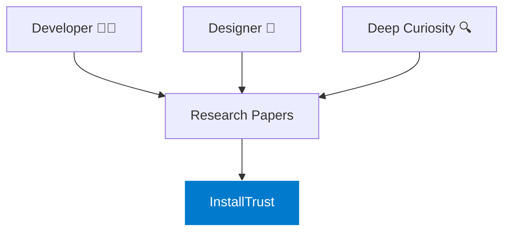
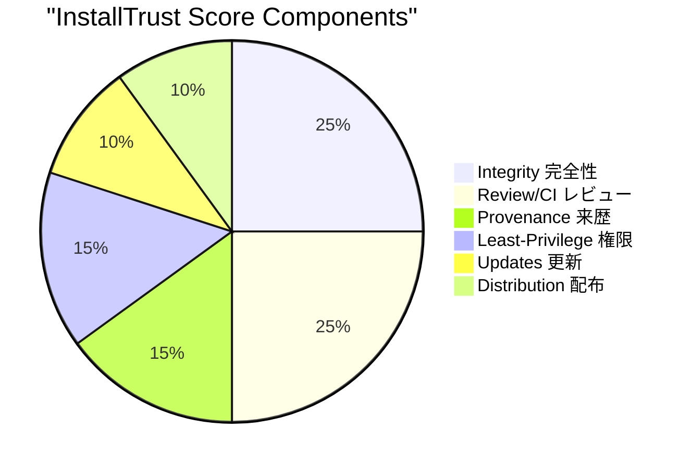
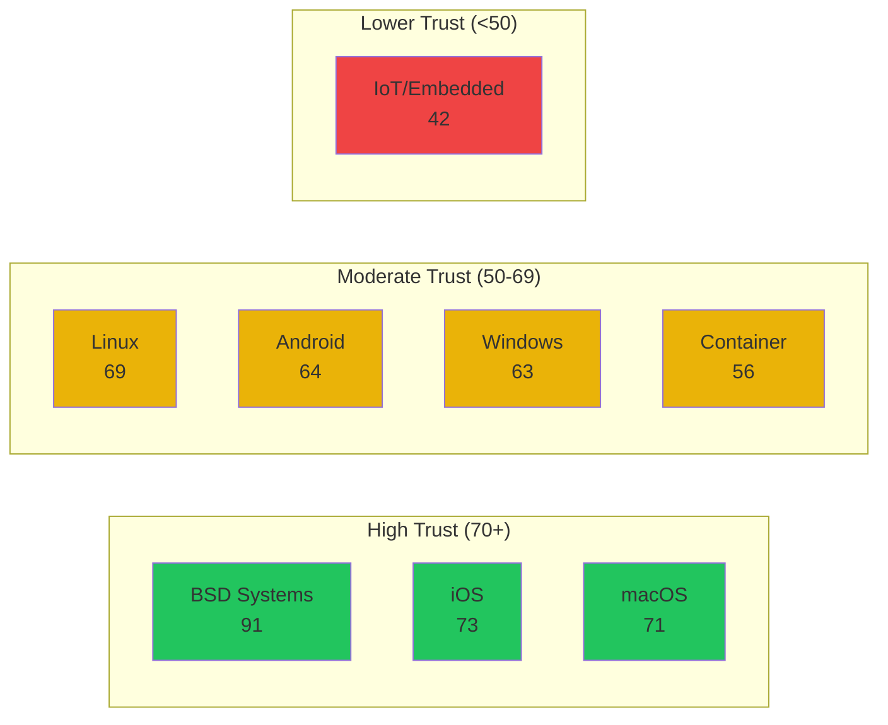
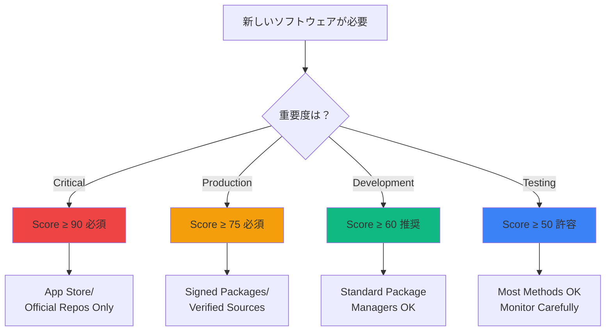

# InstallTrust Score
## ソフトウェアインストールの信頼性を定量化する
### Quantifying Software Installation Trust Across All Platforms

<div class="absolute bottom-10">
  <span class="text-2xl">Günther Brunner (グンタ ブルンナー)</span><br>
  <span class="text-xl opacity-80">株式会社サイバーエージェント AIドリブン推進室</span><br>
  <span class="text-sm opacity-60">2025年9月29日 White Paper Project</span>
</div>

<style>
h1 {
  background-color: #007ACC;
  background-image: linear-gradient(45deg, #007ACC 10%, #00D4FF 30%);
  background-size: 100%;
  -webkit-background-clip: text;
  -webkit-text-fill-color: transparent;
}
</style>

---
layout: intro
---

<p>
<!--
皆さん、こんにちは。本日はInstallTrustについてお話しさせていただきます。
これは、ソフトウェアインストールの信頼性を数値化する、世界初の統一フレームワークです。
20分という短い時間ですが、皆さんの日々の開発作業に直結する、非常に重要な内容をお伝えします。
タイトルスライドでは、自然に話し始め、聴衆の注意を引きつけましょう。
-->
</p>

---

# 自己紹介 <small class="opacity-60">About Me</small>

<div class="grid grid-cols-2 gap-4 mt-8">
<div>

## Günther Brunner
### Not a Researcher, but...

<v-clicks>

- 🎨 **Developer & Designer** <small class="opacity-60">開発者＆デザイナー</small>
- 🔬 **Deep Research Lover** <small class="opacity-60">深い研究が大好き</small>
- 📚 **Paper Writer by Passion** <small class="opacity-60">情熱で論文を書く</small>
- 🌍 **2007年来日** <small class="opacity-60">MEXT Scholar</small>

</v-clicks>

</div>
<div class="flex items-center justify-center">



</div>
</div>

<!--
まず自己紹介をさせてください。
私は研究者ではありません。開発者でありデザイナーです。
しかし、どんなトピックについても深く研究することが大好きで、
これからたくさんの論文を書いていこうと決意しました。
2007年に文部科学省の国費留学生として来日し、
今はサイバーエージェントで働いています。
-->

---
layout: center
---

# なぜこの研究？ <small class="opacity-60">Why This Research?</small>

<div class="text-2xl mt-8">

## 🚀 AIドリブン推進室に異動

<v-clicks>

### Our Mission:
> **エンジニアを最高に生産的にする**
> <small class="block opacity-60">Make engineers maximally productive</small>

### Key Challenge:
> **「何が安全？何が信頼できる？」**
> <small class="block opacity-60">"What's secure? What can be trusted?"</small>

### Why It Matters:
> **MCP, ソフトウェアインストール、ツール選択...**
> <small class="block opacity-60">Critical for MCP, software installation, tool selection...</small>

</v-clicks>

</div>

<!--
なぜこの研究を始めたのか。
私は最近AIドリブン推進室に異動しました。
私たちのミッションは「エンジニアを最高に生産的にする」こと。
そこで直面したのが「何が安全？何が信頼できる？」という議論です。
MCP、ソフトウェアインストール、ツール選択...これらは全て信頼性の問題です。
これはシンプルですが、誰にとっても重要な問題なのです。
-->

---

# The Series Begins Here
## 論文シリーズの第一弾 <small class="opacity-60">First of Many Papers</small>

<div class="grid grid-cols-3 gap-4 mt-12">

<div v-click class="bg-gradient-to-br from-blue-500 to-cyan-500 p-6 rounded-lg text-white">
  <div class="text-6xl mb-4">📊</div>
  <h3 class="text-xl font-bold">Paper #1</h3>
  <p class="mt-2">InstallTrust</p>
  <p class="text-sm opacity-80">Simple & Universal</p>
</div>

<div v-click class="bg-gradient-to-br from-gray-400 to-gray-500 p-6 rounded-lg text-white opacity-60">
  <div class="text-6xl mb-4">🔐</div>
  <h3 class="text-xl font-bold">Paper #2</h3>
  <p class="mt-2">MCP Security</p>
  <p class="text-sm opacity-80">Coming Soon</p>
</div>

<div v-click class="bg-gradient-to-br from-gray-400 to-gray-500 p-6 rounded-lg text-white opacity-60">
  <div class="text-6xl mb-4">🤖</div>
  <h3 class="text-xl font-bold">Paper #3</h3>
  <p class="mt-2">AI Tool Trust</p>
  <p class="text-sm opacity-80">In Planning</p>
</div>

</div>

<div v-click class="mt-8 text-center text-xl">
<p>🎯 <strong>なぜ最初にこれ？</strong></p>
<p class="opacity-80">シンプルで理解しやすく、AIに関係なく全員に関わる</p>
<p class="text-sm opacity-60">Simple, easy to understand, relevant to everyone</p>
</div>

<!--
これは論文シリーズの第一弾です。
なぜ最初にこのトピックを選んだか？
シンプルで理解しやすく、AIに関係なく全員に関わる問題だからです。
誰もがソフトウェアをインストールします。
誰もが知らずにリスクを取っています。
そろそろ、このリスクを数値化する時が来たのです。
-->

---
layout: fact
---

# 742%
## サプライチェーン攻撃の増加率
### Supply chain attacks increase (2019-2023)

<div v-click class="mt-8 text-2xl">
毎日のインストール決定が<br>
組織全体のセキュリティを左右する
</div>

<!--
742%。
この数字を覚えてください。
2019年から2023年にかけて、サプライチェーン攻撃が742%増加しました。
毎日のインストール決定が、組織全体のセキュリティを左右するのです。
一つの悪い選択が、企業全体を危険にさらす可能性があります。
-->

---

# The Hidden Crisis
## 見えない危機 <small class="opacity-60">We Install Without Thinking</small>

<div class="grid grid-cols-2 gap-8 mt-8">
<div>

### 日常の光景 <small class="opacity-60">Daily Scene</small>

```bash
# Morning standup
curl -fsSL https://example.com/install.sh | sh

# Afternoon coding  
npm install random-package

# Evening setup
brew install something

# Late night Docker
docker pull unknown/image
```

</div>
<div v-click>

### 実際のリスク <small class="opacity-60">Actual Risk</small>

<div class="space-y-4">
<div class="bg-red-500/20 p-4 rounded">
  <span class="text-red-500 font-bold">HIGH RISK</span>
  <p class="text-sm">curl | sh = Trust Score: 18</p>
</div>
<div class="bg-yellow-500/20 p-4 rounded">
  <span class="text-yellow-500 font-bold">MEDIUM RISK</span>
  <p class="text-sm">npm = Trust Score: 68</p>
</div>
<div class="bg-green-500/20 p-4 rounded">
  <span class="text-green-500 font-bold">LOW RISK</span>
  <p class="text-sm">Mac App Store = Trust Score: 95</p>
</div>
</div>

</div>
</div>

<!--
これが日常の光景です。
朝のスタンドアップでcurl | sh、午後はnpm install、夕方はbrew install...
でも実際のリスクを見てください。
curl | shのスコアは18。これは25%以上の侵害率を意味します。
一方、Mac App Storeは95。侵害率は0.01%未満です。
この差を理解することが、今日の目的です。
-->

---
layout: center
---

# Major Incidents
## 実際に起きた大事件 <small class="opacity-60">Real World Impact</small>

<div class="grid grid-cols-2 gap-6 mt-8">

<div v-click class="bg-red-900/20 border-2 border-red-500 p-4 rounded-lg">
  <h3 class="text-xl text-red-500 font-bold">SolarWinds (2020)</h3>
  <p>18,000+ organizations compromised</p>
  <p class="text-sm opacity-60">単一のアップデート経由</p>
</div>

<div v-click class="bg-orange-900/20 border-2 border-orange-500 p-4 rounded-lg">
  <h3 class="text-xl text-orange-500 font-bold">XZ Utils (2024)</h3>
  <p>Nation-state backdoor attempt</p>
  <p class="text-sm opacity-60">2年かけた潜入</p>
</div>

<div v-click class="bg-yellow-900/20 border-2 border-yellow-500 p-4 rounded-lg">
  <h3 class="text-xl text-yellow-500 font-bold">npm/PyPI (Daily)</h3>
  <p>400+ malicious packages/month</p>
  <p class="text-sm opacity-60">毎日発見される悪意のあるパッケージ</p>
</div>

<div v-click class="bg-purple-900/20 border-2 border-purple-500 p-4 rounded-lg">
  <h3 class="text-xl text-purple-500 font-bold">CrowdStrike (2024)</h3>
  <p>8.5M Windows devices down</p>
  <p class="text-sm opacity-60">数十億ドルの損害</p>
</div>

</div>

<div v-click class="mt-8 text-2xl text-center">
⚠️ <strong>これらは氷山の一角</strong>
<span class="text-sm block opacity-60">These are just the tip of the iceberg</span>
</div>

<!--
実際に起きた大事件を見てみましょう。
SolarWindsは18,000以上の組織に影響を与えました。単一のアップデート経由で。
XZ Utilsは国家レベルのバックドア試みで、攻撃者は2年かけて信頼を築きました。
npmやPyPIでは毎月400以上の悪意のあるパッケージが発見されています。
CrowdStrikeの更新障害は850万台のWindowsデバイスに影響を与え、
数十億ドルの損害を引き起こしました。
これらは氷山の一角に過ぎません。
-->

---

# The Problem
## 問題の本質 <small class="opacity-60">Core Issues</small>

<div class="grid grid-cols-2 gap-8 mt-8">
<div>

### 🤔 現状 <small class="opacity-60">Current State</small>

<v-clicks>

- **断片化** - 各プラットフォーム独自のセキュリティモデル
- **比較不能** - Homebrewとchocolatey、どっちが安全？
- **定性的** - 「安全」vs「危険」の二元論
- **ガイダンス不足** - 開発者は何を選ぶべき？

</v-clicks>

</div>
<div>

### 📊 必要なもの <small class="opacity-60">What We Need</small>

<v-clicks>

- **統一メトリクス** - プラットフォーム横断の数値化
- **定量的評価** - 0-100のスコアリング
- **実用的** - 意思決定に使える
- **包括的** - 全インストール方法をカバー

</v-clicks>

</div>
</div>

<div v-click class="mt-8 text-center bg-blue-500/20 p-6 rounded-lg">
<div class="text-3xl font-bold">InstallTrust Score</div>
<div class="text-xl mt-2">初の統一フレームワーク</div>
<div class="opacity-60">First unified framework for installation security</div>
</div>

<!--
問題の本質は何か。
現状では、各プラットフォームが独自のセキュリティモデルを持ち、
比較が不可能です。Homebrewとchocolatey、どちらが安全か答えられますか？
全てが「安全」か「危険」の二元論で語られ、定量的な評価がありません。
私たちに必要なのは、統一メトリクス、定量的評価、
実用的で包括的なフレームワークです。
それがInstallTrust Scoreです。
-->

---
layout: section
---

# InstallTrust Score Framework
## 信頼性を測る6つの要素
### Six Criteria for Measuring Trust

<!--
ここからInstallTrust Scoreフレームワークについて説明します。
信頼性を測る6つの要素があります。
これらは実際のセキュリティインシデントの分析から導き出されました。
-->

---

# The Framework
## スコアリング基準 <small class="opacity-60">Scoring Criteria</small>

<div class="mt-6">



</div>

<div class="grid grid-cols-3 gap-4 mt-6 text-sm">
<div class="bg-blue-500/20 p-3 rounded">
<strong>完全性検証 (25%)</strong>
<p class="text-xs opacity-80">署名、ハッシュ、証明書</p>
</div>
<div class="bg-green-500/20 p-3 rounded">
<strong>コードレビュー (25%)</strong>
<p class="text-xs opacity-80">自動/人的レビュー</p>
</div>
<div class="bg-yellow-500/20 p-3 rounded">
<strong>来歴追跡 (15%)</strong>
<p class="text-xs opacity-80">ビルド再現性、SBOM</p>
</div>
<div class="bg-purple-500/20 p-3 rounded">
<strong>権限最小化 (15%)</strong>
<p class="text-xs opacity-80">サンドボックス</p>
</div>
<div class="bg-orange-500/20 p-3 rounded">
<strong>更新セキュリティ (10%)</strong>
<p class="text-xs opacity-80">署名付き更新</p>
</div>
<div class="bg-red-500/20 p-3 rounded">
<strong>配布インフラ (10%)</strong>
<p class="text-xs opacity-80">リポジトリ、CDN</p>
</div>
</div>

<!--
InstallTrust Scoreの6つの構成要素をご覧ください。
最も重要なのは「完全性検証」と「コードレビュー」で、それぞれ25%を占めます。
これは署名、ハッシュ、証明書の検証と、自動または人的レビューです。
「来歴追跡」と「権限最小化」が各15%、
「更新セキュリティ」と「配布インフラ」が各10%です。
これらの重み付けは、実際の攻撃データから検証されています。
-->

---

# Mathematical Foundation
## 数学的基礎 <small class="opacity-60">The Formula</small>

<div class="text-center mt-12">

### InstallTrust Score Formula

$$\mathcal{T}(m,p) = \sum_{i=1}^{6} w_i \cdot c_i(m,p) \cdot \alpha_p$$

<div class="mt-8 text-left max-w-2xl mx-auto">

Where:
- $w_i$ = 基準の重み (criterion weight)
- $c_i(m,p)$ = 基準スコア [0,1] (criterion score)
- $\alpha_p$ = プラットフォーム調整係数 [0.9, 1.1]
- $m$ = インストール方法 (method)
- $p$ = プラットフォーム (platform)

</div>

</div>

<div v-click class="mt-8 bg-gradient-to-r from-blue-500/20 to-purple-500/20 p-4 rounded-lg">
<div class="text-center">
<strong>Result:</strong> 0-100の標準化されたスコア
<span class="block text-sm opacity-60">Standardized score from 0 to 100</span>
</div>
</div>

<!--
数学的基礎を簡単に説明します。
InstallTrust Scoreは、6つの基準の重み付け合計です。
各基準は0から1のスコアを持ち、重みと乗算し、
プラットフォーム調整係数を適用します。
結果は0から100の標準化されたスコアになります。
これにより、異なるプラットフォーム間でも公平な比較が可能になります。
-->

---
zoom: 0.8
---

# Platform Comparison
## プラットフォーム比較 <small class="opacity-60">Average Trust Scores</small>

<div class="mt-8">



</div>

<div class="grid grid-cols-2 gap-4 mt-6">
<div v-click class="bg-green-500/10 p-4 rounded">
<h3>🥇 最高スコア</h3>
<p>BSD Systems: 91</p>
<p class="text-sm opacity-60">OpenBSD ports = 96</p>
</div>
<div v-click class="bg-red-500/10 p-4 rounded">
<h3>📉 最低スコア</h3>
<p>IoT/Embedded: 42</p>
<p class="text-sm opacity-60">Unsigned firmware = 15</p>
</div>
</div>

<!--
プラットフォーム別の平均スコアを見てください。
BSD Systemsが91で最高、IoT/Embeddedが42で最低です。
興味深いのは、iOSが73、Androidが64で、
モバイルプラットフォーム間でも差があることです。
OpenBSD portsの96と、署名なしファームウェアの15では、
81ポイントもの差があります。
-->

---
layout: center
---

# The Trust Gap
## 同じプラットフォーム内の格差
### Same Platform, Vastly Different Security

<div class="mt-8">

| Platform | Best Method | Worst Method | Gap |
|----------|------------|--------------|-----|
| **iOS** | App Store (98) | Jailbreak (15) | **83 points** |
| **macOS** | Mac App Store (95) | curl\|sh (18) | **77 points** |
| **Linux** | Nix/NixOS (94) | curl\|sh (25) | **69 points** |
| **Windows** | MS Store (88) | Unknown EXE (20) | **68 points** |

</div>

<div v-click class="mt-8 text-center bg-yellow-500/20 p-6 rounded-lg">
<div class="text-2xl">⚡ Key Insight</div>
<div class="mt-2">プラットフォームより<strong>インストール方法</strong>が重要</div>
<div class="text-sm opacity-60">Installation method matters more than platform</div>
</div>

<!--
注目すべきポイントです。
同じプラットフォーム内でも、最高と最低の方法間で
80ポイント以上の差があります。
iOSの例では、App Storeが98、脱獄が15でて83ポイントの差。
macOSではMac App Storeが95、curl|shが18でて77ポイントの差。
つまり、プラットフォームよりインストール方法が重要なのです。
-->

---
zoom: 0.8
---

# Trust vs Compromise Rate
## 信頼スコアと侵害率の相関
### The Power of High Scores

<div class="mt-8">

<div class="flex justify-center">
<div class="w-full max-w-2xl">

| Trust Score | 侵害率 | Risk Level |
|------------|--------|------------|
| **90-100** | < 0.01% | 🟢 Minimal |
| **70-89** | 0.1% | 🟢 Low |
| **50-69** | 1% | 🟡 Moderate |
| **30-49** | 10% | 🟠 High |
| **< 30** | > 25% | 🔴 Critical |

</div>
</div>

</div>

<div v-click class="mt-8 bg-gradient-to-r from-green-500/20 to-blue-500/20 p-6 rounded-lg">
<div class="text-center">
<div class="text-3xl font-bold">10ポイント上昇 = 10倍安全</div>
<div class="mt-2 opacity-80">Every 10-point increase = Order of magnitude safer</div>
</div>
</div>

<!--
スコアと侵害率の相関関係をご覧ください。
90-100のスコアでは侵害率は0.01%未満。
30未満のスコアでは25%以上。
スコアが10ポイント上がるごとに、セキュリティが10倍向上します。
これは対数スケールです。
10ポイントの違いが、桁違いの安全性を意味します。
-->

---
layout: section
---

# Android 2026
## パラダイムシフト
### The End of Anonymous Apps

<!--
Android 2026。パラダイムシフトが起こります。
匿名アプリの終わりです。
これからお話しする内容は、モバイルセキュリティの未来を変えます。
-->

---

# Android's Revolution
## 2026年9月：歴史的変更
### September 2026: Historic Change

<div class="grid grid-cols-2 gap-8 mt-8">
<div>

### 📱 現在 <small class="opacity-60">Current (2024)</small>

<v-clicks>

- ✅ 匿名APKインストール可能
- ✅ サイドローディング自由
- ✅ 開発者検証は任意
- ✅ サードパーティストア許可

</v-clicks>

</div>
<div>

### 🔒 2026年後 <small class="opacity-60">After 2026</small>

<v-clicks>

- ❌ 全APKに開発者検証必須
- ❌ 未検証APKは完全ブロック
- ❌ 匿名配布は不可能に
- ❌ 全ストアで身元確認要求

</v-clicks>

</div>
</div>

<div v-click class="mt-8 text-center bg-red-500/20 p-6 rounded-lg">
<div class="text-2xl font-bold">🚨 The End of Open Android</div>
<div class="mt-2 opacity-80">オープンなAndroidの終焉</div>
</div>

<!--
2026年9月、Androidに歴史的変更が起こります。
現在は匿名APKインストールが可能、サイドローディングが自由。
2026年後は、全APKに開発者検証が必須、未検証は完全ブロック。
これはオープンなAndroidの終わりを意味します。
匿名性、自由、プライバシーが大きく制限されます。
-->

---

# Score Impact
## スコアへの影響 <small class="opacity-60">Before & After 2026</small>

<div class="mt-6">

<div class="grid grid-cols-2 gap-4">
<div>

### Before 2026

| Method | Score |
|--------|-------|
| Play Store | 85 |
| Amazon | 78 |
| F-Droid | 76 |
| Galaxy | 80 |
| Enterprise | 72 |
| Verified APK | 55 |
| **Unverified APK** | **55** |
| **3rd Party** | **45** |

</div>
<div>

### After 2026

| Method | Score | Change |
|--------|-------|--------|
| Play Store | 88 | +3 |
| Amazon | 83 | +5 |
| F-Droid | 82 | +6 |
| Galaxy | 85 | +5 |
| Enterprise | 78 | +6 |
| Verified APK | 68 | +13 |
| **Unverified APK** | **0** | **BLOCKED** |
| **3rd Party** | **0** | **BLOCKED** |

</div>
</div>

</div>

<div v-click class="mt-6 text-center bg-purple-500/20 p-4 rounded-lg">
<strong>Platform Convergence:</strong> Android (72) ≈ iOS (73)
<div class="text-sm opacity-60">モバイルプラットフォームの収束</div>
</div>

<!--
スコアへの影響を見てください。
Play Storeは85から88へ、F-Droidは76から82へ上昇。
しかし最も大きな変化は、未検証APKがスコア0で完全ブロックされることです。
サードパーティストアも同様です。
Androidの平均スコアは72、iOSは73。プラットフォームが収束します。
-->

---

# Global Impact
## グローバルな影響 <small class="opacity-60">What This Means</small>

<div class="grid grid-cols-3 gap-4 mt-8">

<div v-click class="bg-blue-500/20 p-4 rounded-lg">
<div class="text-4xl mb-2">🏢</div>
<h3 class="font-bold">Enterprise</h3>
<p class="text-sm">Better security</p>
<p class="text-sm">Higher compliance</p>
<p class="text-xs opacity-60">企業セキュリティ向上</p>
</div>

<div v-click class="bg-orange-500/20 p-4 rounded-lg">
<div class="text-4xl mb-2">👨‍💻</div>
<h3 class="font-bold">Developers</h3>
<p class="text-sm">Verification costs</p>
<p class="text-sm">Privacy concerns</p>
<p class="text-xs opacity-60">検証コスト・プライバシー</p>
</div>

<div v-click class="bg-red-500/20 p-4 rounded-lg">
<div class="text-4xl mb-2">👤</div>
<h3 class="font-bold">Users</h3>
<p class="text-sm">No anonymous apps</p>
<p class="text-sm">Limited freedom</p>
<p class="text-xs opacity-60">自由度の制限</p>
</div>

</div>

<div v-click class="mt-8 bg-gradient-to-r from-red-500/20 to-purple-500/20 p-6 rounded-lg">
<div class="text-center">
<div class="text-xl font-bold">🌍 Both Major Mobile Platforms Now Walled Gardens</div>
<div class="mt-2 opacity-80">両主要モバイルOSがウォールドガーデン化</div>
</div>
</div>

<!--
グローバルな影響を考えてみましょう。
企業にとってはセキュリティ向上とコンプライアンス向上。
開発者にとっては検証コストとプライバシーの懸念。
ユーザーにとっては匿名アプリの終わりと自由度の制限。
両主要モバイルOSがウォールドガーデン化します。
-->

---
layout: section
---

# Practical Implications
## 実践的な意味
### What Should You Do?

<!--
さて、実践的な意味について話しましょう。
あなたの組織では何をすべきか？
ここからは実践的なアドバイスです。
-->

---
zoom: 0.7
---

# For Your Organization
## 組織での実装 <small class="opacity-60">5-Phase Implementation</small>

<div class="mt-8">

<div class="space-y-4">

<div v-click class="flex items-center gap-4 bg-blue-500/10 p-4 rounded-lg">
<div class="text-3xl">1️⃣</div>
<div>
<strong>Baseline Assessment</strong>
<p class="text-sm opacity-80">現在の方法を監査・スコア計算</p>
</div>
</div>

<div v-click class="flex items-center gap-4 bg-blue-500/10 p-4 rounded-lg">
<div class="text-3xl">2️⃣</div>
<div>
<strong>Policy Development</strong>
<p class="text-sm opacity-80">最小許容スコア設定 (Critical: 90, Production: 75)</p>
</div>
</div>

<div v-click class="flex items-center gap-4 bg-blue-500/10 p-4 rounded-lg">
<div class="text-3xl">3️⃣</div>
<div>
<strong>Tool Integration</strong>
<p class="text-sm opacity-80">CI/CDパイプラインに統合</p>
</div>
</div>

<div v-click class="flex items-center gap-4 bg-blue-500/10 p-4 rounded-lg">
<div class="text-3xl">4️⃣</div>
<div>
<strong>Training & Education</strong>
<p class="text-sm opacity-80">開発者・ITスタッフ教育</p>
</div>
</div>

<div v-click class="flex items-center gap-4 bg-blue-500/10 p-4 rounded-lg">
<div class="text-3xl">5️⃣</div>
<div>
<strong>Continuous Improvement</strong>
<p class="text-sm opacity-80">四半期ごとの見直し・更新</p>
</div>
</div>

</div>

</div>

<!--
組織での5フェーズ実装を提案します。
フェーズ1：現在の方法を監査し、ベースラインを設定。
フェーズ2：ポリシー開発。クリティカルは90、プロダクションは75。
フェーズ3：CI/CDパイプラインに統合。
フェーズ4：開発者とITスタッフを教育。
フェーズ5：四半期ごとの見直しと更新。
-->

---

# Platform Recommendations
## プラットフォーム別推奨事項
### What to Use on Each Platform

<div class="grid grid-cols-2 gap-6 mt-6">

<div>

### Desktop Platforms

<div class="space-y-3 mt-4">

<div class="bg-gradient-to-r from-blue-500/20 to-blue-600/20 p-3 rounded">
<strong>Windows</strong>
<p class="text-sm">MS Store (88) > Chocolatey signed (72) > WinGet (70)</p>
</div>

<div class="bg-gradient-to-r from-gray-500/20 to-gray-600/20 p-3 rounded">
<strong>macOS</strong>
<p class="text-sm">Mac App Store (95) > Nix (93) > Homebrew Cask (75)</p>
</div>

<div class="bg-gradient-to-r from-orange-500/20 to-orange-600/20 p-3 rounded">
<strong>Linux</strong>
<p class="text-sm">Nix/NixOS (94) > Guix (93) > Flatpak (80) > Snap (75)</p>
</div>

</div>

</div>

<div>

### Mobile & Special

<div class="space-y-3 mt-4">

<div class="bg-gradient-to-r from-green-500/20 to-green-600/20 p-3 rounded">
<strong>iOS</strong>
<p class="text-sm">App Store Only (98) - 他は危険</p>
</div>

<div class="bg-gradient-to-r from-purple-500/20 to-purple-600/20 p-3 rounded">
<strong>Android</strong>
<p class="text-sm">Play Store (85→88) > Amazon (78→83) > F-Droid (76→82)</p>
</div>

<div class="bg-gradient-to-r from-cyan-500/20 to-cyan-600/20 p-3 rounded">
<strong>Container</strong>
<p class="text-sm">Docker Official (82) > Verified Publisher (75)</p>
</div>

</div>

</div>

</div>

<!--
各プラットフォームの推奨事項です。
WindowsではMicrosoft Storeが88、Chocolatey署名付きが72。
macOSではMac App Storeが95、Nixが93。
LinuxではNix/NixOSが94、Guixが93。
iOSではApp Storeのみが98。他の選択肢は全て危険です。
Androidは2026年前後で大きく変わります。
-->

---

# Avoid These Methods
## 絶対に避けるべき方法
### Trust Score < 30 = Critical Risk

<div class="mt-8">

<div class="grid grid-cols-2 gap-6">

<div class="space-y-4">

<div class="bg-red-500/20 border-2 border-red-500 p-4 rounded-lg">
<h3 class="text-red-500 font-bold">curl | sh Scripts</h3>
<p>Score: 15-25</p>
<p class="text-sm opacity-60">最も危険な方法</p>
</div>

<div class="bg-red-500/20 border-2 border-red-500 p-4 rounded-lg">
<h3 class="text-red-500 font-bold">Unknown PowerShell</h3>
<p>Score: 20</p>
<p class="text-sm opacity-60">Windowsでの危険</p>
</div>

<div class="bg-red-500/20 border-2 border-red-500 p-4 rounded-lg">
<h3 class="text-red-500 font-bold">Jailbreak/Root</h3>
<p>Score: 15</p>
<p class="text-sm opacity-60">セキュリティ完全無効化</p>
</div>

</div>

<div class="space-y-4">

<div class="bg-orange-500/20 border-2 border-orange-500 p-4 rounded-lg">
<h3 class="text-orange-500 font-bold">Unknown 3rd Party Stores</h3>
<p>Score: 25-45</p>
<p class="text-sm opacity-60">検証なし配布</p>
</div>

<div class="bg-orange-500/20 border-2 border-orange-500 p-4 rounded-lg">
<h3 class="text-orange-500 font-bold">Unsigned Binaries</h3>
<p>Score: 20-30</p>
<p class="text-sm opacity-60">改ざんリスク高</p>
</div>

<div class="bg-orange-500/20 border-2 border-orange-500 p-4 rounded-lg">
<h3 class="text-orange-500 font-bold">Random npm packages</h3>
<p>Score: 30-40</p>
<p class="text-sm opacity-60">レビューなし依存関係</p>
</div>

</div>

</div>

</div>

<!--
絶対に避けるべき方法を説明します。
スコア30未満は重大なリスクを表します。
curl | shスクリプトは15-25で最も危険。
不明なPowerShellは20、脱獄/rootは15。
未署名バイナリは20-30、ランダムなnpmパッケージは30-40。
これらは全て、組織全体を危険にさらす可能性があります。
-->

---
layout: center
---

# Real-World Decision Tree
## 実践的な判断フロー
### How to Choose Installation Methods



<!--
実践的な判断フローを示します。
新しいソフトウェアが必要な時、まず重要度を判断します。
クリティカルならスコア90以上が必須。
プロダクションなら75以上、開発なら60以上、テストなら50以上。
この決定ツリーに従うことで、適切なセキュリティレベルを保てます。
-->

---

# Developer Best Practices
## 開発者のベストプラクティス
### How to Achieve High Trust Scores

<div class="grid grid-cols-2 gap-6 mt-8">

<div>

### 📝 Distribution Strategy

<v-clicks>

1. **コード署名実装** - All binaries & installers
2. **包括的CI/CD** - Automated tests & security scans
3. **SBOM公開** - Full dependency transparency
4. **複数配布チャネル** - Prioritize high-trust options
5. **定期監査** - Third-party assessments

</v-clicks>

</div>

<div>

### 🎯 Target Scores by Type

<div class="space-y-3 mt-4">

<div class="flex justify-between items-center bg-green-500/20 p-3 rounded">
<span>Security Tools</span>
<span class="font-bold">≥ 90</span>
</div>

<div class="flex justify-between items-center bg-blue-500/20 p-3 rounded">
<span>Dev Tools</span>
<span class="font-bold">≥ 75</span>
</div>

<div class="flex justify-between items-center bg-yellow-500/20 p-3 rounded">
<span>Utilities</span>
<span class="font-bold">≥ 60</span>
</div>

<div class="flex justify-between items-center bg-purple-500/20 p-3 rounded">
<span>Demo/POC</span>
<span class="font-bold">≥ 50</span>
</div>

</div>

</div>

</div>

<!--
開発者のベストプラクティスです。
コード署名を実装し、全てのバイナリとインストーラーに署名。
包括CI/CDで自動テストとセキュリティスキャン。
SBOMを公開して完全な依存関係の透明性を提供。
複数の配布チャネルをサポートし、高信頼オプションを優先。
定期的な第三者監査を受けることも重要です。
-->

---
layout: section
---

# Key Takeaways
## 重要なポイント
### What to Remember

<!--
最後に、重要なポイントをまとめます。
今日お伝えしたい最も重要なメッセージを確認しましょう。
-->

---
zoom: 0.7
---

# The Five Key Messages
## 覚えておくべき5つのメッセージ

<div class="space-y-6 mt-8">

<div v-click class="bg-gradient-to-r from-blue-500/20 to-purple-500/20 p-6 rounded-lg">
<h3 class="text-2xl mb-2">1. 方法 > プラットフォーム</h3>
<p>インストール方法の選択がプラットフォームより重要</p>
<p class="text-sm opacity-60">Method choice matters more than platform choice</p>
</div>

<div v-click class="bg-gradient-to-r from-green-500/20 to-cyan-500/20 p-6 rounded-lg">
<h3 class="text-2xl mb-2">2. 10ポイント = 10倍安全</h3>
<p>スコア10ポイント上昇で攻撃成功率が桁違いに減少</p>
<p class="text-sm opacity-60">Every 10 points = order of magnitude safer</p>
</div>

<div v-click class="bg-gradient-to-r from-yellow-500/20 to-orange-500/20 p-6 rounded-lg">
<h3 class="text-2xl mb-2">3. 2026年 = モバイル統一</h3>
<p>AndroidとiOSが実質的に同じセキュリティモデルに</p>
<p class="text-sm opacity-60">Mobile platforms converge in 2026</p>
</div>

</div>

<!--
5つの重要なメッセージ、まず3つ。
第一に、インストール方法の選択がプラットフォームより重要。
第二に、スコア10ポイント上昇で攻撃成功率が桁違いに減少。
第三に、2026年にAndroidとiOSが実質的に同じセキュリティモデルに。
これらを覚えておいてください。
-->

---

# More Key Messages
## さらに重要なポイント

<div class="space-y-6 mt-8">

<div v-click class="bg-gradient-to-r from-red-500/20 to-pink-500/20 p-6 rounded-lg">
<h3 class="text-2xl mb-2">4. curl | sh = 自殺行為</h3>
<p>スコア18の方法は組織全体を危険にさらす</p>
<p class="text-sm opacity-60">Score 18 methods endanger entire organizations</p>
</div>

<div v-click class="bg-gradient-to-r from-purple-500/20 to-indigo-500/20 p-6 rounded-lg">
<h3 class="text-2xl mb-2">5. 高信頼方法は既に存在</h3>
<p>各プラットフォームで90+スコアの方法が利用可能</p>
<p class="text-sm opacity-60">High-trust methods already exist on every platform</p>
</div>

</div>

<div v-click class="mt-8 text-center text-2xl bg-gradient-to-r from-green-500/20 to-blue-500/20 p-6 rounded-lg">
<strong>選択は私たちの手に</strong>
<div class="text-lg opacity-80">The choice is in our hands</div>
</div>

<!--
さらに2つの重要なメッセージ。
第四に、curl | shはスコア18、これは自殺行為に等しい。
第五に、高信頼方法は既に各プラットフォームに存在する。
私たちはただ選択するだけで良いのです。
選択は私たちの手にあります。
-->

---

# Action Items
## 今すぐできること
### Immediate Actions You Can Take

<div class="grid grid-cols-2 gap-8 mt-8">

<div>

### 🚀 Today <small class="opacity-60">今日</small>

<v-clicks>

- curl | shを即座に停止
- 現在の方法を監査
- チームと共有

</v-clicks>

</div>

<div>

### 📅 This Week <small class="opacity-60">今週</small>

<v-clicks>

- 最小スコアポリシー設定
- 高信頼代替案の特定
- CI/CD統合の計画

</v-clicks>

</div>

</div>

<div v-click class="mt-8 bg-gradient-to-r from-blue-500 to-purple-500 text-white p-6 rounded-lg">
<div class="text-center">
<div class="text-2xl font-bold mb-2">Remember</div>
<div class="text-lg">Every install decision is a security decision</div>
<div class="mt-2 opacity-80">すべてのインストール決定はセキュリティ決定</div>
</div>
</div>

<!--
今すぐできることを説明します。
今日：curl | shを即座に停止、現在の方法を監査、チームと共有。
今週：最小スコアポリシー設定、高信頼代替案の特定、CI/CD統合の計画。
覚えておいてください。
すべてのインストール決定はセキュリティ決定です。
-->

---
layout: center
---

# Resources & Tools
## リソースとツール

<div class="grid grid-cols-2 gap-6 mt-8">

<div>

### 📚 Paper & Research

- **Full Paper**: [GitHub Repository]
- **Score Calculator Tool**: 
  - 🔗 [github.com/code-agents/installtrust](https://github.com/code-agents/installtrust)
- **Documentation**: Full methodology
- **Updates**: Follow for latest research

</div>

<div>

### 🛠 Integration Tools

- **GitHub Action**: Coming soon
- **CLI Tool**: `npx installtrust check`
- **VS Code Extension**: In development
- **API**: REST API for automation

</div>

</div>

<div class="mt-8 text-center bg-gradient-to-r from-green-500/20 to-blue-500/20 p-4 rounded-lg">

### 🎯 Calculate Your Score Today!

<div class="text-lg mt-2">
<strong>https://github.com/code-agents/installtrust</strong>
</div>
<div class="text-sm opacity-60 mt-2">
オープンソースツールで今すぐスコアを計算
</div>

</div>

<!--
リソースとツールをご紹介します。
完全な論文とスコア計算ツールはGitHubで公開しています。
https://github.com/code-agents/installtrust
ここでオープンソースツールを使って、今すぐ自分のインストール方法の
スコアを計算できます。
CLIツールはnpx installtrust checkで簡単に使えます。
GitHub ActionやVS Code拡張機能も開発中です。
ご質問、アイデア、コラボレーションのご相談は
メールでお待ちしています。
-->

---
layout: center
---

# Try It Now!
## 今すぐ試してみよう

<div class="mt-8">

```bash
# Install the CLI tool
npm install -g @code-agents/installtrust

# Check your current installation methods
installtrust check --platform macos

# Analyze a specific method
installtrust score "homebrew"

# Get recommendations
installtrust recommend --min-score 75
```

</div>

<div class="mt-8 text-center">
<div class="text-3xl font-bold mb-4">
🔗 github.com/code-agents/installtrust
</div>

<div class="grid grid-cols-3 gap-4 mt-6">
<div class="bg-blue-500/20 p-4 rounded">
<div class="text-2xl">📊</div>
<p>Instant Scoring</p>
</div>
<div class="bg-green-500/20 p-4 rounded">
<div class="text-2xl">🔍</div>
<p>Method Analysis</p>
</div>
<div class="bg-purple-500/20 p-4 rounded">
<div class="text-2xl">📈</div>
<p>Improvement Tips</p>
</div>
</div>

</div>

<!--
実際にツールを使ってみましょう。
npm install -g @code-agents/installtrustでインストール。
installtrust checkで現在の方法をチェック。
installtrust scoreで特定の方法を分析。
installtrust recommendで推奨事項を取得。
GitHubで公開していますので、ぜひ試してみてください。
即座にスコアを計算し、分析し、改善のヒントを提供します。
-->

---
layout: section
---

# Join My Research Journey
## 一緒に研究しませんか？
### Looking for Collaborators

<!--
ここで重要なお知らせがあります。
私は一緒に研究と実験をしてくれる人を探しています。
特にAI Coding AgentsとMCPに興味がある方、ぜひご連絡ください。
-->

---

# Research Opportunities
## 研究テーマと協力者募集

<div class="grid grid-cols-2 gap-8 mt-8">

<div>

### 🤖 AI Coding Agents
<v-clicks>

- **Autonomous Development** <small class="opacity-60">自律的開発</small>
- **Code Generation Quality** <small class="opacity-60">コード生成品質</small>
- **Tool Integration** <small class="opacity-60">ツール統合</small>
- **Security in AI Development** <small class="opacity-60">AI開発のセキュリティ</small>

</v-clicks>

</div>

<div>

### 🔌 MCP (Model Context Protocol)
<v-clicks>

- **Security Framework** <small class="opacity-60">セキュリティフレームワーク</small>
- **Trust Models** <small class="opacity-60">信頼モデル</small>
- **Permission Systems** <small class="opacity-60">権限システム</small>
- **Safe Integration Patterns** <small class="opacity-60">安全な統合パターン</small>

</v-clicks>

</div>

</div>

<div v-click class="mt-8 text-center bg-gradient-to-r from-purple-500/20 to-blue-500/20 p-6 rounded-lg">
<div class="text-2xl font-bold">🚀 Let's Build the Future Together</div>
<div class="mt-2 opacity-80">未来を一緒に作りましょう</div>
</div>

<!--
私が今注目している研究分野です。
AI Coding Agentsでは、自律的開発、コード生成品質、ツール統合、
そしてAI開発におけるセキュリティを研究しています。
MCPでは、セキュリティフレームワーク、信頼モデル、権限システム、
安全な統合パターンに焦点を当てています。
これらの分野で一緒に未来を作りたい方を探しています。
-->

---
layout: center
---

# Next Paper: DELTA
## 次の論文：DELTA
### Dynamic Evaluation & Learning Through Adaptation

<div class="mt-12 text-4xl font-bold gradient-text">
Δ (Delta) = Change = Progress
</div>

<div class="mt-8 text-2xl">
AIエージェントの動的評価と適応学習
</div>

<!--
次の論文を紹介させてください。
DELTA - Dynamic Evaluation & Learning Through Adaptation。
デルタは変化を意味し、それは進歩を意味します。
AIエージェントがどのように動的に評価し、適応学習するかを研究しています。
-->

---

# DELTA Research Framework
## DELTA研究フレームワーク

<div class="mt-8">

<div class="grid grid-cols-2 gap-6">

<div class="space-y-4">

### 📊 Dynamic Evaluation
<div class="bg-blue-500/10 p-4 rounded-lg">
- **Real-time Performance Metrics** <small class="opacity-60">リアルタイム性能指標</small>
- **Contextual Assessment** <small class="opacity-60">文脈的評価</small>
- **Multi-dimensional Analysis** <small class="opacity-60">多次元分析</small>
</div>

### 🧠 Adaptive Learning
<div class="bg-green-500/10 p-4 rounded-lg">
- **Self-improvement Loops** <small class="opacity-60">自己改善ループ</small>
- **Error Pattern Recognition** <small class="opacity-60">エラーパターン認識</small>
- **Strategy Evolution** <small class="opacity-60">戦略進化</small>
</div>

</div>

<div class="space-y-4">

### 🔄 Continuous Optimization
<div class="bg-purple-500/10 p-4 rounded-lg">
- **Feedback Integration** <small class="opacity-60">フィードバック統合</small>
- **Performance Tuning** <small class="opacity-60">性能チューニング</small>
- **Resource Optimization** <small class="opacity-60">リソース最適化</small>
</div>

### 🎯 Application Domains
<div class="bg-orange-500/10 p-4 rounded-lg">
- **Code Generation** <small class="opacity-60">コード生成</small>
- **Security Analysis** <small class="opacity-60">セキュリティ分析</small>
- **System Integration** <small class="opacity-60">システム統合</small>
</div>

</div>

</div>

</div>

<!--
DELTAフレームワークには4つの主要コンポーネントがあります。
動的評価では、リアルタイムの性能指標と文脈的評価を行います。
適応学習では、自己改善ループとエラーパターン認識を実装します。
継続的最適化では、フィードバックを統合して性能を向上させます。
そして、コード生成、セキュリティ分析、システム統合に応用します。
-->

---

# Why DELTA Matters
## なぜDELTAが重要か

<div class="grid grid-cols-3 gap-6 mt-8">

<div v-click class="bg-gradient-to-br from-red-500/20 to-orange-500/20 p-6 rounded-lg hover-card">
<div class="text-4xl mb-4">📈</div>
<h3 class="text-xl font-bold">Performance Gap</h3>
<p class="mt-2">Current AI agents plateau quickly</p>
<p class="text-sm opacity-60">現在のAIエージェントはすぐに頭打ち</p>
</div>

<div v-click class="bg-gradient-to-br from-blue-500/20 to-cyan-500/20 p-6 rounded-lg hover-card">
<div class="text-4xl mb-4">🔄</div>
<h3 class="text-xl font-bold">No Adaptation</h3>
<p class="mt-2">Static evaluation models</p>
<p class="text-sm opacity-60">静的な評価モデルのみ</p>
</div>

<div v-click class="bg-gradient-to-br from-green-500/20 to-lime-500/20 p-6 rounded-lg hover-card">
<div class="text-4xl mb-4">🎯</div>
<h3 class="text-xl font-bold">Context Blindness</h3>
<p class="mt-2">Ignore environmental factors</p>
<p class="text-sm opacity-60">環境要因を無視</p>
</div>

</div>

<div v-click class="mt-8 bg-gradient-to-r from-purple-500/20 to-pink-500/20 p-6 rounded-lg">
<div class="text-center">
<div class="text-2xl font-bold">DELTA Solves These Problems</div>
<div class="mt-2">動的評価 + 適応学習 = 継続的改善</div>
<div class="text-sm opacity-60">Dynamic Evaluation + Adaptive Learning = Continuous Improvement</div>
</div>
</div>

<!--
なぜDELTAが重要なのか。
現在のAIエージェントはすぐに性能が頭打ちになります。
静的な評価モデルしかなく、適応能力がありません。
そして環境要因を無視してコンテキストブラインドです。
DELTAはこれらの問題を解決し、継続的改善を実現します。
-->

---

# Collaborate With Me
## 一緒に研究しましょう

<div class="grid grid-cols-2 gap-8 mt-8">

<div>

### 🎯 Looking For <small class="opacity-60">求める人材</small>

<v-clicks>

- **Researchers** who love deep dives
- **Engineers** who build robust systems  
- **Designers** who think differently
- **Anyone** passionate about AI safety

</v-clicks>

</div>

<div>

### 💡 What We'll Do <small class="opacity-60">やること</small>

<v-clicks>

- Write cutting-edge papers
- Build practical tools
- Run experiments
- Change the industry

</v-clicks>

</div>

</div>

<div v-click class="mt-8 bg-gradient-to-r from-blue-500 to-purple-500 text-white p-8 rounded-lg text-center">
<div class="text-3xl font-bold mb-4">Join the Research Revolution</div>
<div class="text-xl">gunther_brunner@cyberagent.co.jp</div>
<div class="mt-4 text-lg opacity-90">
Let's write papers that matter.<br/>
Let's build tools that protect.<br/>
Let's make AI development safer together.
</div>
</div>

<!--
一緒に研究したい人を探しています。
深い研究が好きな研究者、堅牢なシステムを構築するエンジニア、
異なる視点で考えるデザイナー、AIの安全性に情熱を持つ全ての人。
最先端の論文を書き、実用的なツールを構築し、
実験を行い、業界を変えていきましょう。
意味のある論文を書き、保護するツールを構築し、
AI開発をより安全にしていきましょう。
-->

---
layout: end
---

# Thank You!
## ご清聴ありがとうございました

<div class="text-center mt-8">

### Let's make software installation safer together
### 一緒にソフトウェアインストールを安全にしましょう

<div class="mt-8 text-xl opacity-80">
株式会社サイバーエージェント<br/>
AIドリブン推進室<br/>
Günther Brunner
</div>

<div class="mt-8 text-lg">
<strong>研究協力者募集中 / Looking for Collaborators</strong><br/>
gunther_brunner@cyberagent.co.jp
</div>

<div class="mt-4 text-sm opacity-60">
InstallTrust → MCP Security → DELTA → The Future
</div>

</div>

<!--
ご清聴ありがとうございました。
一緒にソフトウェアインストールを安全にしましょう。
そして、一緒に未来を作りましょう。
InstallTrust、MCP Security、DELTA、そしてその先へ。
研究に興味がある方は、ぜひご連絡ください。
セキュリティを通じてエンジニアの生産性を最大化する、
これが私たちのミッションです。
一緒に世界を変えましょう。
ご質問はありますか？
-->
